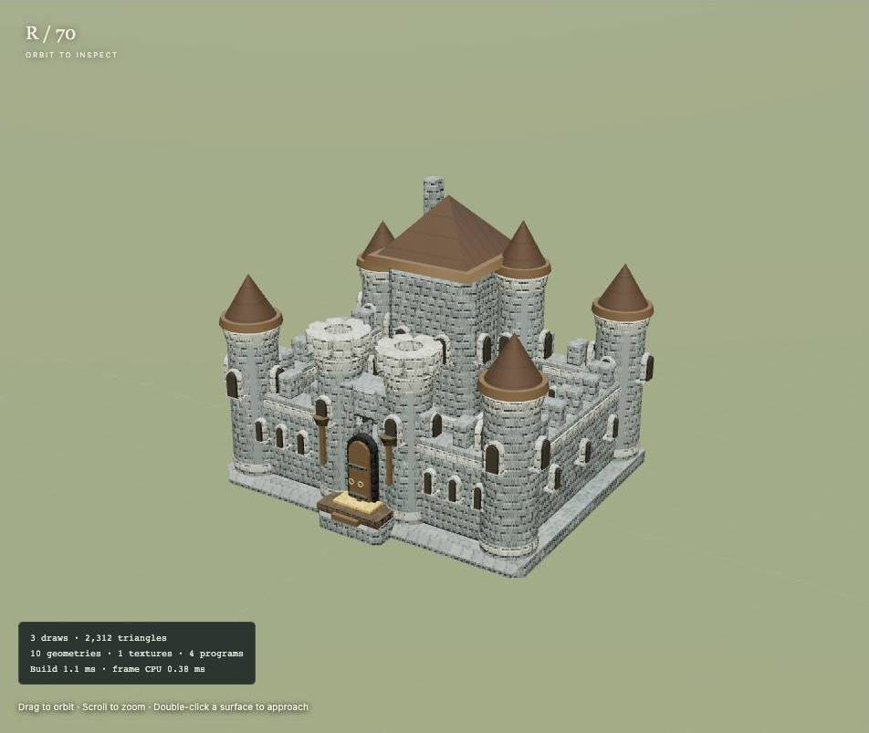
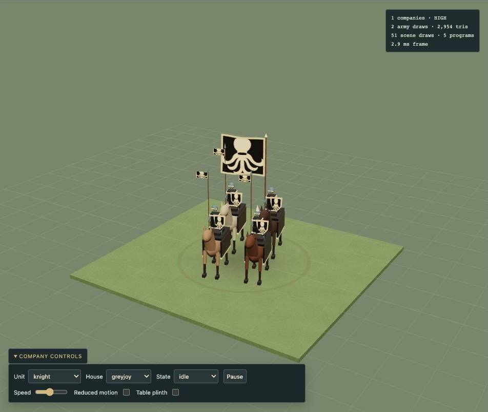
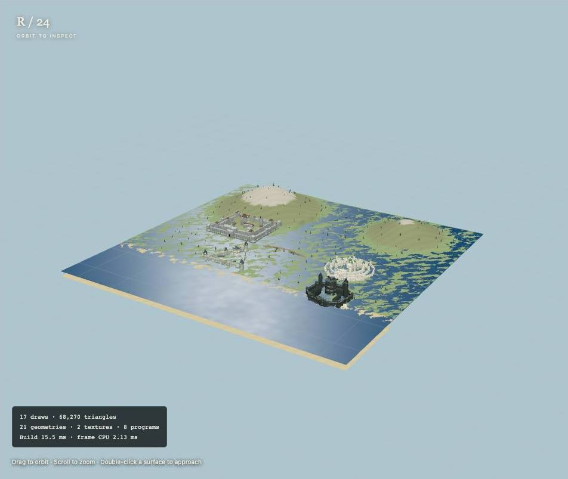
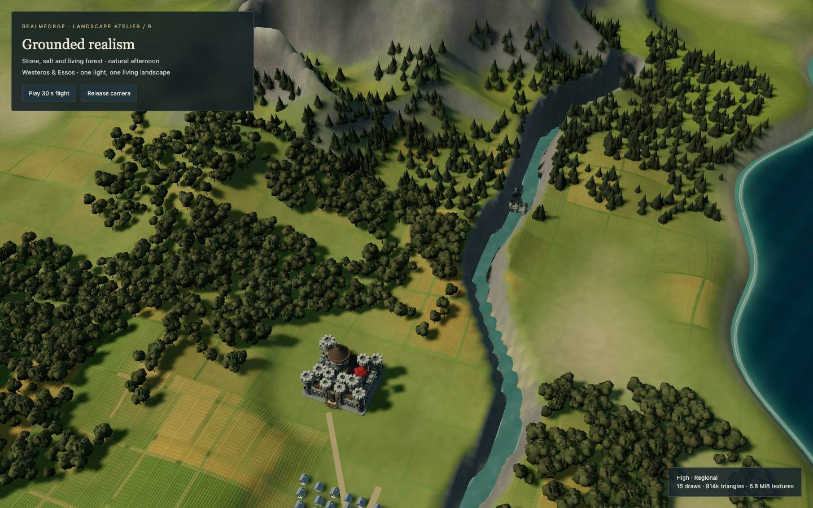
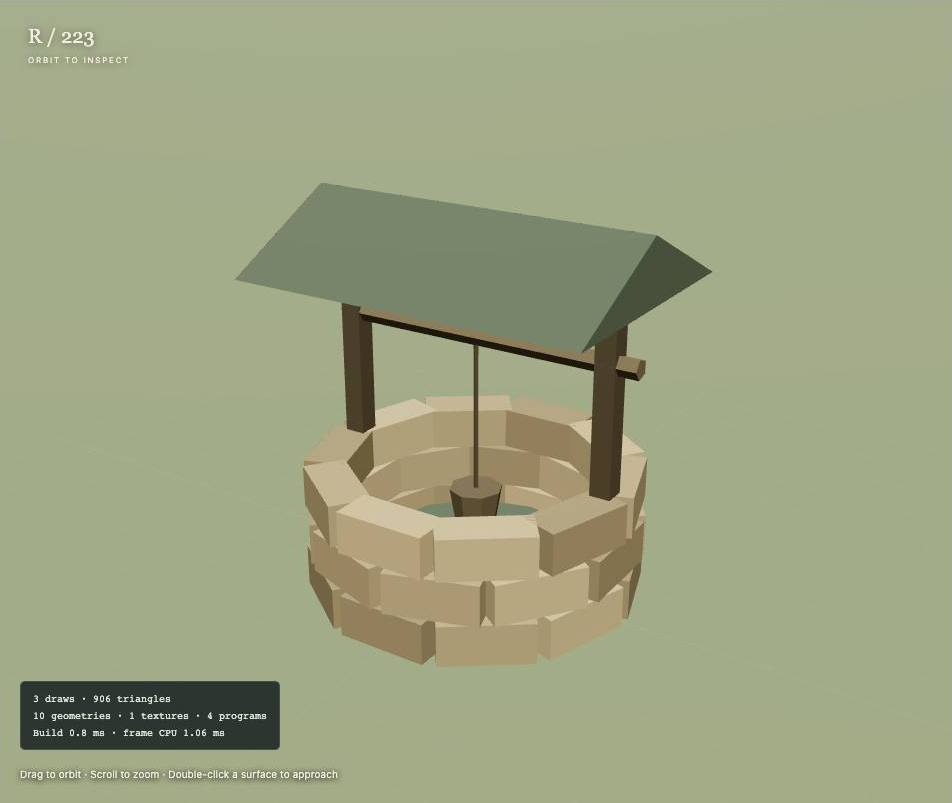

# Realmforge

Realmforge is a source-first TypeScript and three.js library for procedural medieval worlds: castles, cities, animated companies, dragons, nature and everyday props. Browse each building block in an interactive gallery, compare detail levels and palettes, then compose your own scene with small builders and explicit lifecycle hooks. Realmforge was **extracted from the GPL-3.0 game Swords and Ravens** and expanded with original procedural artwork.







## Quick start

Requires Node.js **22.12 or newer** and a browser with WebGL 2.

```sh
npm ci
npm run dev -- --port 5231       # interactive gallery; Ctrl-C when finished
npm run typecheck
npm run build                   # production gallery → dist-gallery/
npm run preview -- --port 5232   # optional manual preview; Ctrl-C when finished
```

The gallery is also prepared for [GitHub Pages](https://bujosa.github.io/realmforge/) once the repository owner enables the supplied Pages workflow. Local development/preview ports are configurable with Vite's `--port` flag. This repository keeps `"private": true` to prevent accidental npm publication; it is a source library, **not a published npm package**. Use a local source dependency or vendor the required modules and notices into a TypeScript bundler such as Vite. three.js is a peer dependency pinned to **0.186.1**.

## Explore the gallery

Search the catalogue, open a study and drag to orbit, scroll to zoom or double-click a surface to approach. The phone catalogue opens in a drawer. Inspect architecture, seed, tint, variant, LOD and quality in the component controls. Stage controls include turntable, wireframe, bounds, grid, ground, light, fog and pixel ratio. **Copy QA link** preserves the study and control values in its URL.

Press **E** for free flight, **G** for a street-level walk, **Escape** for orbit. Drag to look; WASD/arrows move; Q/E move down/up; Shift accelerates; the wheel adjusts speed. Touch uses the movement pad and drag/pinch gestures. The navigation selector also works without shortcuts. Camera pose and speed are not serialized. Walking uses approximate geometry collision, not a game physics engine. See [exploration controls and limits](docs/exploration.md).

Open `#lookdev/landscape` to compare A/B/C, High/Balanced and World/Regional/Close/Eastern coast camera studies. B is the chosen Grounded realism direction, refined through the game port; see [parameters and review history](docs/lookdev.md).

Open `#qa` for the complete sequential thumbnail sheet; select any thumbnail to inspect it. [Gallery authoring contract](docs/gallery.md).

## Source API

```ts
import * as THREE from 'three';
import { castleGeometry, CastleMaterial } from 'realmforge';

const geometry = castleGeometry('stronghold', 'north');
const material = new CastleMaterial();
const castle = new THREE.Mesh(geometry, material);
scene.add(castle); // scene and renderer belong to your application

// When removing the castle:
scene.remove(castle);
geometry.dispose();
material.dispose();
```

The package export resolves TypeScript source; consumers must compile it. Builders return geometry or scene objects; dynamic handles receive your clock and explicit `dispose()` calls. Terrain, water, palettes, public cues and heraldic artwork are injectable. No game model, fog state, authentication or application singleton is required. Metre-scale components use **50 metres per scene unit**; board miniatures have their own authored scale. [Architecture](docs/architecture.md), [scale](docs/scale.md), [extraction map](docs/extraction-map.md).

## Catalogue

| Domain | Contents | Documentation |
|---|---|---|
| Look development | Three live art directions; chosen B with regional moor, fertile patchwork, grouped forest canopies and restrained sea/haze | [Landscape look development](docs/lookdev.md) |
| Explore | 26 inhabited seat/city studies and a river-to-coast landscape | [Explore](docs/exploration.md) |
| Pieces | Original footman, knight, siege engine, ship and dragon references | [Pieces](docs/pieces.md) |
| Armies | Instanced companies, ten motion states, terrain/heraldry studies and board budgets | [Armies](docs/armies.md) |
| Wildlings | Public threat track, warning and attack presentation, current reference | [Wildlings](docs/wildlings.md) |
| Castles | Ten styles, 24 landmark recipes, modular CC0 kit and details | [Castles](docs/castles.md) |
| Cities & seats | Physical complexes, seven complete cities, two board cities, island seats and house kits | [Cities](docs/cities.md) |
| Nature | Flora, grass, canopy, rocks, riverbank and livestock | [Nature](docs/nature.md) |
| Props | 55 composer modules, resources, harbours, bridges, camps, torches and smoke | [Props](docs/props.md) |
| Dragons | Skeletal dragon, wing membrane, flight and fire | [Dragons](docs/dragons.md) |
| Effects | Nine particle presets, scorch and ship wakes | [Effects](docs/effects.md) |
| Tokens | Injectable screen-space order and power faces | [Tokens](docs/tokens.md) |
| Materials | Castle/city, ice, water, surface arrays and procedural fallback | [Materials](docs/materials.md) |
| Heraldry | Injectable SVG geometry/atlas and original abstract demo marks | [Heraldry](docs/heraldry.md) |
| Scale / core / presets | Coordinate frame, pools, lifecycle and optional named recipes | [Core](docs/core.md), [presets](docs/presets.md) |

The [complete catalogue](docs/catalogue.md) includes the current gallery inventory and the audit of all 424 frozen tabletop source files. Named regions and house names in `src/presets/**` and the gallery are **demo data**. Internal compatibility keys retain those names so extracted recipes keep working.

## Visual QA and performance

```sh
npx playwright install chrome webkit    # one-time browser setup; Chrome is a system install
npm run build
npm run qa
node qa/explore.cjs                    # optional walk/fly review with recordings
```

QA uses the local Playwright devDependency. It starts one temporary production preview, refuses an occupied port and always stops its own exact child PID in `finally`, including failure/interruption. Run QA commands sequentially; stop any manual preview first. All browsers run headless. Chrome uses Metal/GPU flags on macOS; WebKit supplies a Safari-adjacent check. Desktop **1440×900** and phone **390×844** captures use JPEG quality 72, with per-category contact sheets and `results.json`. The runner checks console/WebGL errors, failed requests, full-object framing, URL control persistence, search, drawer navigation and the thumbnail sheet. Cinematic threat studies use their existing Free orbit option for the full-object framing review.

| Environment variable | Default | Purpose |
|---|---|---|
| `QA_OUTPUT_DIR` | `./qa-output` (gitignored) | Captures, logs and result files |
| `QA_PORT` | `5232` | Local owned preview port |
| `QA_BASE_PATH` | `/` | Preview path for builds with an explicit base, e.g. `/realmforge/` |
| `QA_FILTER` | all stories | Story ID regular expression for focused visual review |

`node qa/armies.cjs` and `node qa/wildlings.cjs` provide domain contracts and longer performance/motion reviews; `--quick` skips expanded captures. They share the same output/port settings. `ARMY_EVIDENCE` remains a legacy army-output alias. `node qa/armies-perf.cjs` measures full drawing buffers separately from the smaller gallery pane.

Runtime stats show draw calls, triangles, geometry/texture counts, synchronous build time and CPU submission time. These are **not GPU timings or a stable FPS benchmark**. Full cities can block during synchronous construction; the library also supplies sliced generation for hosts. Use instancing, far LOD and balanced quality for many objects; profile your target devices. The gallery eagerly loads its study registry and currently emits a large JavaScript chunk. Textures/models load locally with procedural fallback. Synthetic flat terrain/shorelines differ from a game's streamed world.

## Licenses and credits

- Library code, original procedural geometry, gallery and its original abstract demo sigils: **GPL-3.0-only**, [LICENSE](LICENSE). Contributions use this same license; [contribution guide](CONTRIBUTING.md).
- Kenney Castle Kit 2.0, optimized `castle-kit.glb`: **CC0**, [asset notice](src/materials/assets/licenses/Kenney-Castle-Kit.txt).
- ambientCG Wood051, Paper001, Bricks052 and Metal032 WebP maps, by Lennart Demes: **CC0**, [notice](src/materials/assets/licenses/ambientCG.txt), [CC0 text](src/materials/assets/licenses/CC0-1.0.txt).
- Poly Haven terrain/masonry KTX2 arrays: **CC0**, [layer attribution](src/materials/assets/world/ATTRIBUTION.md). Basis transcoder JS/WASM is supplied by three.js and retains its upstream notices.
- three.js is MIT; meshoptimizer decoder is MIT; Basis Universal transcoder is Apache-2.0. Full runtime and art notices are included in [the gallery license file](gallery/public/licenses.txt) and shipped with the compiled gallery. Development tools retain their own package licenses. Screenshots show this repository's procedural scenes and credited bundled assets.

**Unofficial fan-made work. Not affiliated with or endorsed by HBO, George R. R. Martin or Fantasy Flight Games.** No official character artwork, heraldic emblems or show assets are bundled. Hosts are responsible for rights to artwork they inject.
