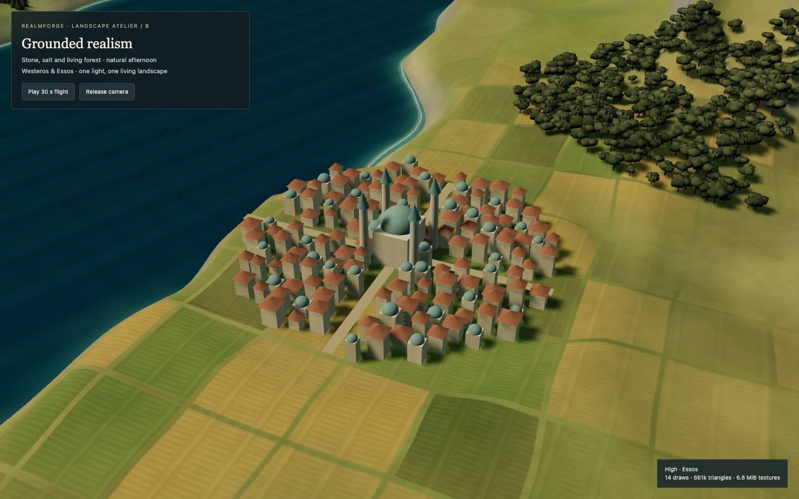

# Landscape look development

Open **Look development → Three ways to a living world** (`#lookdev/landscape`).
Choose an art direction, High/Balanced and World x20/Regional/Close/Essos. All
controls are URL-addressable. **Play 30 s flight** visits the northern mountains,
castle, fields, strait and eastern harbor. **Release camera** enables gallery
flight (drag, WASD, Q/E); wheel reduces travel speed for close inspection.

## Direction and recommendation

**B · Grounded realism is the chosen direction.** Its material, canopy and coast
strategy has been ported to the game's World ×20 view and refined over three
regional review rounds. The library now mirrors those refinements in B only;
A and C remain available with their original output.




This is an original synthetic landscape, not a geographic reconstruction. The
eastern coast receives the same terrain, material, vegetation LOD, water, light
and settlement detail. No ownership or locked-state input changes its beauty.
The harbor city is a neutral procedural study. No official screen artwork or
new external assets are used.

### Refinement history

| Round | Game feedback carried back into library B |
| --- | --- |
| 1 · Material and light port | Natural PBR ground/value range, regional vegetation, near cutout leaves, saline depth/shallows/foam and restrained atmosphere. |
| 2 · Fertile regions | Green pasture/cereal/vineyard patchwork, grouped broadleaf canopies, fertile eastern grassland/river valley and olive-like low broadleaf silhouettes; less sea glare. |
| 3 · Regional separation | Yellow-green northern moor between rock and light frost, stronger agricultural parcel contrast, sunlit crowns and shaded gaps, lower haze. |

The game remains authoritative for production geography, climate fields and
placement. Library climate masks use synthetic coordinates; these are an art
study, not a replacement map or a claim of exact game-image parity. The generic
eastern broadleaf recipe suggests orchard vegetation rather than providing a
new botanically exact olive model.

### B parameters are data

`groundedRealism` in `src/lookdev/directions.ts` supplies B's palette, parcel
size/blend, frost/moor/valley weights, crown width/value range, sea specular and
foam limits, and haze cap. Only B receives this optional `Direction.grounding`
record; A/C run their original material and placement branches. No global nature
or material implementation changes are required.

| Parameter | Value | Purpose |
| --- | --- | --- |
| Moor / frost | `#879933` / `#bdc9bb` | Separate open northern ground from stone and alpine snow |
| Pasture / cereal / vines | `#618537` / `#c49e4d` / `#4b642d` | Readable cultivated parcels |
| Valley / woodland | `#748b43` / `#344c24` | Fertile eastern catchment and shaded forest floor |
| Parcel size / blend | `3.2 × 3.8` units / `0.88` | Seeded patchwork; derivative-filtered vineyard rows |
| Moor / frost / valley weights | `0.66` / `0.22` / `0.72` | Regional mix limits, independent of ownership |
| Crown width / shade range | `1.15` / `0.70–1.20` | Grouped crowns with lit tops and shaded gaps; same instances |
| Sea specular / foam multiplier | `0.30` / `0.55` | Limit glare while retaining depth, shallows and surf |
| Fog density cap | `0.00168` | Preserve regional landscape visibility |

No geometry, texture download, draw pass, instance count or dependency is added.
B adds a canopy instance-color buffer bounded by 54,000 bytes in High and
33,600 bytes in Balanced (actual accepted broadleaf counts are lower).
The shader adds procedural climate/land-use samples; measure its GPU cost on
consumer hardware rather than inferring it from the unchanged geometry budget.

## Boundaries and lifecycle

- `src/lookdev/directions.ts`: numeric art settings and deterministic analytic
  height, shore and river functions. The CPU and water shader share formulas.
- `src/lookdev/surfaces.ts`: continuous PBR terrain, slope/height/climate blending,
  triplanar rock sampling, fields/vineyards, analytic coastal shallows/foam,
  layered waves and procedural gradient/cloud sky.
- `src/lookdev/vegetation.ts`: seeded regional species, packed instanced batches,
  detailed near foliage, low geometry silhouettes and distant overhead impostors.
  The existing canopy atlas is reused; a tiny original procedural leaf texture
  supplies B/C cutouts. A uses solid crowns. No runtime image dependency.
- `src/lookdev/settlements.ts`: the sampler's production castle/home geometries,
  a neutral procedural harbor city and terrain-conforming roads. Flat sites blend
  into the heightfield rather than placing a separate display slab underneath.
- `src/lookdev/index.ts`: portable content factory, readiness, frame updates,
  texture accounting and disposal. No game singleton or gallery dependency.
- `gallery/stories/lookdev/landscape.ts`: gallery-only lights, UI and camera
  adapter. Restores scene state and disposes scene-owned sky, shadows and arrays.

No existing story, shared nature/material implementation, public barrel,
package dependency or army/heraldry/wildling file was changed. Import directly
from `src/lookdev` while this remains a prototype. Failures in CC0 preparation
remain visible and do not report false readiness.

The gallery lacks a camera-preset hook. The adapter switches its public camera
control to flight and temporarily owns `scene.onBeforeRender`, updating camera
matrices after gallery navigation and before render projection. This is kept
outside portable content. Free flight releases preset ownership. Downstream
code should use its own camera controller, not copy this adapter.

## Camera provenance and comparison limits

Vertical FOV is 38°, matching the game's `TabletopScene.ts`. World x20 uses the
saved r6-armies/r3 default **offset** `(0, 134.50025294, 38.67615919)`, translated to
the sampler. That preserves the 73.95° inclination and measured world distance.
Portrait expands distance to retain the subject. Regional uses the saved
regional direction `(0.25, 0.75, 0.66)` at a larger landscape-study distance;
Close deliberately frames a complete castle rather than a single soldier.

The contact sheets include the supplied production screenshots, with their UI,
and the synthetic sampler. They are art-direction comparisons, not pixel-matched
before/after claims, and the phone viewport is desktop browser emulation.

## Costs and quality controls

High uses a 384×320 terrain grid, up to 4,500 seeded tree candidates, packed near
cutouts within 18 units, low silhouettes elsewhere and overhead oak impostors
beyond 60 units. One 1024² directional shadow map is shared. Balanced uses a
224×190 grid, 2,800 candidates, low geometry trees/impostors and no shadow map.
Trees rejected by site/height/river rules never allocate per-tree draw calls.

Existing 512²×6 albedo/normal/roughness KTX2 arrays are loaded once per scene.
Texture memory includes their actual transcoded mip byte lengths, two 512²
RGBA canopy textures with estimated mip chains, and the 128² leaf texture.
High adds an 8 MiB shadow target (4 MiB RGBA color + 4 MiB depth); default framebuffer and browser-managed
render targets are not included. GPU compression differs by engine. No new
asset download or licensing work is necessary; source licenses remain under
`src/materials/assets/licenses` and `assets/world/ATTRIBUTION.md`.

All visible material variants are compiled asynchronously. A tiny offscreen
render with at least one instance per LOD prewarms the shadow/cutout variants.
Do this before exposing the game camera. Never introduce a material variant in
the motion loop. Browser instrumentation counts actual `createProgram` calls.
The evidence report contains measured frame intervals and budgets; CPU submission
time in the gallery HUD is not a GPU frame-time claim.

## Porting plan: game files, incremental cost and risks

Paths below are relative to `agot-bg-game-server/src/client/tabletop/` in the
existing game. They were inspected read-only. No game worktree was changed.

| Option | Game files to adapt | Expected incremental cost | Principal risks |
| --- | --- | --- | --- |
| A | `world/WorldMaterial.ts`, `WorldTerrain.ts`, `WorldScenery.ts`, `WorldSky.ts`, `WorldWater.ts`; lighting in `scene/TabletopScene.ts` | Primarily uniform/palette and light changes; add macro/slope blending, canopy edge variation and shared surf function. No postprocessing pass. | Bright foliage can compete with region markers; illustrative crowns remain visible close up. |
| B | A's files plus `world/WorldHeightfield.ts`, `WorldOceanField.ts`, material-array adapter and vegetation geometry/LOD owner | Reuse present CC0 arrays. Add two leaf material variants, one cutout depth variant and packed instance updates; optional shared 1024² shadow map. | Texture/normal scale must use game metres, LOD transitions need hysteresis, shader precision and mobile GPU fill rate need a game benchmark. |
| C | B's files plus `world/WorldNorth.ts` and climate values supplied to `WorldMaterial.ts`/`WorldSky.ts` | A few climate/cloud uniforms and terrain shader samples; no screen-space effect. | North can become too dark, winter overlays may double snow, fog can conceal tactical labels. |

Keep existing game surface heights, coast-distance/river fields, castle placement
and permission/visibility contracts authoritative. **Do not port this synthetic
heightfield, demo street layout or neutral city recipe as game geography.** Port
only the material weights, species/LOD strategy, shared shore response and
lighting settings. Derive snow and species from public climate, never ownership
or hidden game state. Reuse `scene/geometry/CastleMaterial.ts` and
`realism/cities/CityMaterial.ts` for equivalent stone grain; keep their semantic
attributes and exclusions intact.

The port used the following staged approach; retain it for future consumers: (1) behind an opt-in art flag, add uniform-driven terrain and
sea settings with existing geographic inputs; (2) add instanced species/LOD and
prewarm; (3) test castle ground contact and city entrances against production
height data; (4) compare full game x20 in Chrome/WebKit, labels, locks and phone;
(5) retain the chosen B direction while reviewing each production region. Rollback is the original
art flag; keep saves, rules, navigation and gameplay unchanged.

The prototype's low-detail castle crenellations, rounded mountain relief and
plain city blocks still need artistic refinement before promising film-like
closeups. A direction approval is separate from approval to ship the result.

## Reproduce evidence

The portable runners and environment variables are documented in
[qa/README.md](../qa/README.md). Run commands sequentially under `nice -n 10`:

```sh
nice -n 10 npm run typecheck
nice -n 10 npm run build
nice -n 10 env QA_PORT=5250 LOOKDEV_ONLY=B node qa/lookdev.cjs full
nice -n 10 env LOOKDEV_ONLY=B node qa/lookdev-sheets.cjs
nice -n 10 node qa/lookdev-report.cjs
nice -n 10 npm run build -- --base=/realmforge/
git diff --check
```

The capture runner owns a single headless preview through `qa/server.cjs` and
stops its exact PID in `finally`, including failure. Chrome uses Metal flags;
WebKit supplies the Safari-adjacent review. All screenshot evidence is JPEG
quality 72. Optional videos record the canvas for 30 seconds at 24 fps. The
separate parity runner captures every protected story plus A/C at a frozen clock
for before/after pixel comparison. No UI regression test suite is added.
